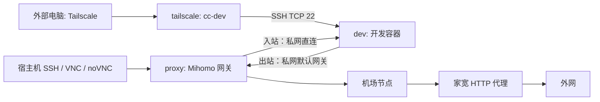

# cc-runtime

使用 Docker Compose 运行开发环境，并通过独立的 Mihomo 网关访问外网。适用于 macOS OrbStack 和 Linux Docker Engine，不依赖 OrbStack 的全局代理设置。

## 网络结构



三个常驻容器拥有独立的网络命名空间：

| 服务 | 网络 | 职责 |
|---|---|---|
| `dev` | 仅私网，`172.30.0.10` | 开发工具、SSH 和远程桌面 |
| `proxy` | 私网 `172.30.0.2` + 出口网络 | TCP 透明代理、DNS、开发服务入站转发 |
| `tailscale` | 私网 `172.30.0.3` + 出口网络 | Tailscale 接入，仅转发 SSH 到 `dev:22` |
| `dev-network-init` | 临时共享 `dev` 的网络命名空间 | 设置默认路由和 DNS 防绕过规则，然后退出 |

`dev` 不设置代理环境变量，也不共享 `proxy` 的网络、配置和凭据。只有临时初始化容器获得 `NET_ADMIN`；开发容器不保留该权限，并移除了 `NET_RAW`。

## 文件

```text
compose.yaml                    服务、网络、权限、端口和挂载
Dockerfile                      开发镜像
entrypoint.sh                   初始化开发服务
proxy/config.example.yaml       Mihomo 配置模板
proxy/config.yaml               自行填写的实际配置，不提交 Git
proxy/resolv.conf               开发容器使用网关 DNS
scripts/proxy-entrypoint.sh     网关防火墙初始化与 Mihomo 启动
scripts/dev-network-init.sh     开发容器网络初始化，完成后退出
scripts/dev.py                  扫描依赖、初始化总卷、管理 Compose
tailscale/config/serve.json      Tailscale 私网 SSH 转发配置
tailscale/state/                Tailscale 登录状态，不提交 Git、不进入镜像构建
AGENTS.md                      服务目录和持久化约定
dependency-rules.json           项目标记与目录隔离规则
.runtime/                      自动生成的挂载配置和路径清单，不提交 Git
dev-runtime/home/                       dev 家目录的宿主机存储，不提交 Git、不进入镜像构建
dev-runtime/ssh-host-keys/              SSH 主机密钥的宿主机存储，不提交 Git、不进入镜像构建
```

`proxy` 和临时辅助容器直接使用 `metacubex/mihomo:latest`，不构建代理镜像。该镜像已包含脚本使用的 `ip`、`iptables`、`nc` 和 shell。这里使用 TCP REDIRECT，不需要 TUN 或 `/dev/net/tun`。

## 启动

1. 复制配置模板：

   ```bash
   cp proxy/config.example.yaml proxy/config.yaml
   chmod 600 proxy/config.yaml
   ```

2. 编辑 `proxy/config.yaml`：

   - 将 `airport` 替换为 Clash 订阅中的一个完整节点，保留名称 `airport` 和节点全部协议参数。不导入机场的分流规则。
   - 填写 `residential` 的家宽 HTTP 代理地址、端口和账号密码，保留 `dialer-proxy: airport`。
   - 如果家宽提供的是 HTTPS 代理，按服务商要求增加 `tls: true`。

   这是原生 Mihomo YAML，不会自动替换 `${变量}`。脚本会拒绝启动仍包含模板占位符的配置。

3. 复制环境变量示例，并在 `.env` 中填写 `PASSWORD`，作为开发用户的 SSH/VNC 密码：

   ```bash
   cp .env.example .env
   ```

   Compose 自动读取 `.env`；密码为空或未设置时会报错。`.env` 已加入 Git 忽略列表。

4. 检查配置并启动：

   ```bash
   docker compose config --quiet
   docker compose run --rm --no-deps --entrypoint /mihomo proxy \
     -t -f /root/.config/mihomo/config.yaml
   python3 scripts/dev.py up
   # 若本地已有镜像且不想更新，可改用 up --no-pull
   python3 scripts/dev.py compose ps -a
   python3 scripts/dev.py compose logs proxy dev-network-init dev
   ```

`dev-network-init` 正常状态是 `Exited (0)`，它不是常驻服务。`dev` 正常启动开发服务，不等待路由初始化；默认路由设置完成前，启动阶段的外网请求可能失败，需要重试。网关健康检查只确认本地监听端口，不能证明真实机场和家宽代理连通。

开发镜像构建时的下载使用 Docker 构建网络，不在此运行时代理链内。

`dev` 使用 `America/New_York` 时区，自动切换美国东部标准时间（EST）与夏令时（EDT）。

## 访问开发环境

| 服务 | 宿主机地址 | 网关私网转发目标 |
|---|---|---|
| SSH | `ssh -p 2222 dev@127.0.0.1` | `172.30.0.10:22` |
| VNC 客户端 | `127.0.0.1:5901` | `172.30.0.10:5901` |
| 浏览器 noVNC | `http://127.0.0.1:6080/vnc.html` | `172.30.0.10:6080` |

这些连接由 Mihomo 的固定 `DIRECT` tunnel 在 Docker 私网转发，**不经过机场或家宽代理**。开发工作区直接绑定宿主机 `/Users/zeke/workspace` 到容器 `/home/dev/workspace`，两端文件修改会互相可见。迁移到 Linux 时需修改宿主机路径并确保开发用户具有写权限；入口脚本不会递归修改已有工作区的所有者。

### 通过 Tailscale 远程 SSH

`tailscale` 使用独立网络命名空间和 userspace 网络模式，不需要 TUN、`NET_ADMIN` 或宿主机端口映射。它直接连接外网，并通过 Tailscale Serve 的 TCP 转发把 tailnet 内的 `22` 端口送到 `172.30.0.10:22`。SSH 握手和用户认证由 `dev` 的 OpenSSH 完成，不启用 Tailscale SSH、Funnel、子网路由或出口节点。开发容器的出站仍经过原有 Mihomo 网关。

首次执行 `python3 scripts/dev.py up` 后查看登录链接（首次启动预留 30 分钟完成浏览器登录）：

```bash
python3 scripts/dev.py compose logs tailscale
```

在浏览器打开日志中的 `https://login.tailscale.com/a/...` 链接，登录自己的 tailnet 并批准设备。如果 tailnet 开启设备审批，还需完成审批。然后在 Tailscale 管理后台的 Machines 页面为 `cc-dev` 设置 **Disable key expiry**，避免无人值守设备到期要求重新认证。此设置需要在账号后台完成，保存容器状态本身不会关闭密钥过期。

外部电脑加入同一个 tailnet 后：

```bash
ssh dev@cc-dev
# 未启用 MagicDNS 时，改用以下命令显示的 Tailscale IPv4 地址：
python3 scripts/dev.py compose exec tailscale tailscale ip -4
```

默认设备名为 `cc-dev`，可通过 `.env` 的 `TS_HOSTNAME` 修改；名称冲突时以管理后台实际名称为准。tailnet 的 ACL/grants 需要允许客户端访问该设备 TCP 22。首次使用新设备名/IP 连接时，客户端仍可能要求确认一次 SSH 指纹。

`tailscale/config/serve.json` 只开放 SSH；远程桌面和其他开发端口不自动开放。可以先用 SSH 端口转发访问，例如 `ssh -L 6080:127.0.0.1:6080 dev@cc-dev`，然后打开本机 `http://127.0.0.1:6080/vnc.html`。

Tailscale 登录状态保存在宿主机 `tailscale/state/`，挂载到 `/var/lib/tailscale`，设置 `TS_AUTH_ONCE=true` 后重启和重建继续复用身份。不要删除该目录或同时给另一台在线设备复用它。首次认证无需把 auth key 写入项目。

### SSH 主机密钥持久化

服务端主机密钥保存在宿主机 `./dev-runtime/ssh-host-keys/` 目录，挂到 `/var/lib/cc-runtime/ssh`。启动时只为缺失的密钥生成新值，校验已有密钥，并通过 sshd 的 `HostKey` 配置引用；不挂载整个 `/etc/ssh`。新镜像不携带默认主机密钥。Compose 挂载仓库的 `entrypoint.sh`，现有开发镜像也可以立即使用这套启动逻辑。

`scripts/dev.py prepare` / `up` 在第一次初始化主机密钥目录时，会从现有 `dev` 容器（包括已停止的容器）迁移主机密钥，再执行重建。**首次升级先执行这两个命令之一，不要先删除旧容器或直接用 Compose 重建。** 如果已经没有旧容器和密钥备份，就只能生成新身份，客户端需要核对新指纹后更新信任记录。

客户端登录公钥仍在 `dev-runtime/home/.ssh/authorized_keys`，已随整个 `/home/dev` 持久化，不需要额外挂载。SSH 主机身份与用户登录授权是两套不同的数据。

SSH 密钥目录和 Tailscale 状态目录由启动脚本初始化，普通 `down` 和 `down -v` 均保留。迁移机器时需同时备份、恢复 `dev-runtime/ssh-host-keys/`、`tailscale/state/` 和 `dev-runtime/home/`，并停止旧机器上的同一 Tailscale 身份。不要将私钥或 Tailscale 状态提交 Git。重启/重建会中断已有会话，但保留这些数据后不需要重新配置客户端密钥。

### Mihomo 控制 API（不部署 UI）

在你已有的 Clash/Mihomo 面板中填写：

- 后端地址：`http://127.0.0.1:19090`
- API Secret：与 `.env` 中的 `PASSWORD` 相同。

网关入口脚本通过 Mihomo 的 `-ext-ctl` 和 `-secret` 参数开启 API，无需将密码另写进代理 YAML。容器内监听 `9090`，宿主机映射为 `19090`，避免与常见的本地代理控制端口混淆；默认仅限宿主机本机访问，不安装或下载 UI。

修改 `.env` 后需要重新创建代理容器，单纯 `restart` 不会重新加载容器环境变量：

```bash
python3 scripts/dev.py compose up -d --no-deps --force-recreate proxy
```

### 持久化 dev 家目录

当前目录下的 `dev-runtime/home/` 绑定到容器 `/home/dev`。Shell 配置、Claude 登录状态、SSH 文件和用户安装的工具等会保留在这里，容器重建后仍然可用。

```text
./dev-runtime/home                    → /home/dev
/Users/zeke/workspace          → /home/dev/workspace（单独覆盖挂载）
依赖总卷的缓存子目录          → /home/dev/.cache（单独覆盖挂载）
```

`python3 scripts/dev.py up` / `prepare` 会在第一次使用家目录时，从已经构建的开发镜像复制 `/home/dev` 中的初始工具和配置，保留文件权限和符号链接。已有同名文件不覆盖；不复制镜像中的 `workspace`、`.cache`。Claude 和 Rust 在 Dockerfile 切换到 `USER dev` 后安装，分别位于 `~/.local` 和 `~/.cargo` / `~/.rustup`。Rust 使用 minimal profile，避免可选离线文档的大小写文件名在 macOS 挂载目录发生冲突。初始化完成后写入 `.cc-runtime-home-initialized` 标记，后续启动不重复复制，也不会用新镜像覆盖用户改动。因此重建镜像不会自动升级持久化家目录中的 Claude/Rust 等工具，需要在容器里自行更新。

仓库本身位于宿主机 workspace 中，**这允许嵌套挂载，不会自动把整个 workspace 递归复制进家目录**。容器也能通过 `/home/dev/workspace/github_work/cc-runtime/dev-runtime/home` 看到家目录的底层文件；这个别名下的 `workspace` 不承载 `/home/dev/workspace` 的子挂载。扫描器会根据家目录挂载路径自动跳过它，避免将家目录中的工具、依赖和缓存当成工作项目扫描。

`dev-runtime/home/` 已加入 Git 与 Docker 构建忽略列表。它存放的是 Linux 开发环境数据，不是 macOS 的用户家目录；不要把其中的 Linux 工具直接用于 Mac，切换容器 CPU 架构时也需要重新安装相关二进制工具。备份家目录可复制 `dev-runtime/home/`，但工作区与依赖缓存属于另外两个挂载，需要分别备份。

Playwright 的系统依赖由 root 安装，Chromium 由 dev 下载到 `/home/dev/.local/share/ms-playwright`，通过 `PLAYWRIGHT_BROWSERS_PATH` 统一指定安装和运行时路径，避免浏览器落在 `/root` 或被缓存卷覆盖。首次初始化家目录时会一起复制浏览器；已有初始化标记的家目录不会自动补装，可在更新镜像并重建容器后，以 dev 执行 `playwright install chromium`。

### 单卷隔离依赖与构建产物

源码继续共享 `/Users/zeke/workspace`。启动脚本扫描项目，为依赖和构建产物生成子目录挂载，全部存放在 **一个外部 Docker 卷** 中：默认名为 `cc-runtime_dependencies`，前缀跟随 Compose 项目名。

```text
Mac workspace/my-project/src       ← 共享 → dev workspace/my-project/src
Mac workspace/my-project/.venv     ← 独立 → 总卷中的该项目 .venv 子目录
Mac workspace/my-project/target    ← 独立 → 总卷中的该项目 target 子目录
```

首次在容器中重新安装依赖。宿主机依赖不会被复制进卷，也不会被容器覆盖；重新创建开发容器后仍保留容器依赖。卷内按 Linux 架构、宿主机工作区路径、项目相对路径分区，避免不同工作区及 ARM/x86 混用二进制。路径使用稳定哈希，实际路径与卷子目录的对应关系记录在 `.runtime/dependencies.json` 中。

需要宿主机 `python3`（仅标准库）、Docker Engine 和支持 `volume.subpath` 的 Compose。本机已验证 Docker Engine 29.4.0 / Compose 5.1.2。子目录会在启动开发容器前，由一次性 `docker run --rm` 创建并按开发镜像中的真实 `dev` UID/GID设置所有者；不增加常驻服务，也不修改宿主机依赖的所有者。

#### 默认规则

| 识别依据 | 隔离目录 |
|---|---|
| `package.json` | `node_modules` |
| Python 项目标记，如 `pyproject.toml`、`requirements*.txt` | `.venv` |
| 目录中存在 `pyvenv.cfg` | 整个虚拟环境，包含 `.vnev` 等自定义名字 |
| `Cargo.toml` / `pom.xml` | `target` |
| Gradle 项目标记 | `build`、`.gradle` |
| `pubspec.yaml` | `build`、`.dart_tool` |
| `.csproj` / `.fsproj` | `bin`、`obj` |
| Next/Nuxt/Svelte 配置 | 对应 `.next`、`.nuxt`、`.output`、`.svelte-kit` |
| 已存在的明确缓存目录 | Ruff、pytest、mypy、Turbo 等配置中列出的目录 |

按项目标记识别的目录，即使尚不存在，也会提前生成挂载。扫描不会进入已隔离的依赖目录，不会逐个处理依赖包。`build`、`dist`、`bin`、`vendor` 不会仅凭名称全部屏蔽；项目类型规则也可以自行删改。

`__pycache__` 不生成独立挂载。通过 `PYTHONPYCACHEPREFIX=/home/dev/.cache/python/pycache` 将 Python 字节码缓存统一写到总卷的缓存子目录，现有宿主机 `__pycache__` 不删除、仍可见。常规遵循该设置的 Python 解释器使用独立缓存；使用 `-E`/`-I` 忽略环境变量的解释器或自行管理缓存的工具不在此保证内。`XDG_CACHE_HOME` 同样指向总卷内的 `/home/dev/.cache`。

开发镜像使用 `ghcr.io/zeke-chin/cc-runtime:latest`，提供 Linux AMD64 和 ARM64，Docker 自动选择对应架构。`up` 默认拉取镜像，`up --no-pull` 使用本地缓存（兼容旧参数 `--no-build`）。如需本地构建，可执行 `docker build -t ghcr.io/zeke-chin/cc-runtime:latest .`，再运行 `up --no-pull`。若提示另一条 `dev.py` 命令仍在运行，等待其结束再重试，不要并行执行两次启动。

GitHub Actions 使用 `ubuntu-24.04` 和 `ubuntu-24.04-arm` 分别原生构建 AMD64、ARM64，不使用 QEMU。两个构建按架构隔离 Actions 缓存，分别推送镜像 digest；全部成功后再合并多架构 manifest，发布 `main` / `latest`（默认分支）及 `sha-*` 标签，并检查发布结果包含两个架构。修改 Dockerfile、`.dockerignore`、入口脚本、`shell/` 或发布 workflow 会触发构建，也可手动运行。首次使用新缓存 scope 时会完整构建；后续可复用未变更的工具安装层。

#### 日常命令

```bash
# 只扫描并生成挂载清单，不创建卷、不启动容器、不修改项目文件
python3 scripts/dev.py scan

# 拉取开发镜像、重新扫描、初始化总卷、重建并启动相关服务
python3 scripts/dev.py up

# 已有开发镜像时，跳过拉取；新增项目后可用这个命令更新挂载
python3 scripts/dev.py up --no-pull

# 仅扫描和初始化卷，要求本地已有开发镜像
python3 scripts/dev.py prepare

# 使用同一份生成配置查看日志、执行命令和停止服务
python3 scripts/dev.py compose logs dev
python3 scripts/dev.py compose exec dev zsh
python3 scripts/dev.py compose down
```

`.runtime/compose.dependencies.json` 是自动生成的 Compose 附加文件。**启用隔离后，通过上述脚本启动，不要直接用裸 `docker compose up`**，否则不会加载这些挂载。扫描后无需手工编辑生成文件。

新增项目、worktree，或者创建了此前无法从项目标记预测的缓存目录，需要重新执行 `up --no-pull`。更新挂载会重建容器并中断开发会话；普通源码修改实时共享，不需要重新扫描或重启。运行中不自动热插拔挂载，新增目录在重新扫描前仍属于宿主机共享路径。

#### 自定义规则与清理

编辑 `dependency-rules.json`：

- `directory_names`：按名称隔离已存在的明确依赖/缓存目录。
- `project_rules`：按同目录的项目文件名识别；`markers` 支持文件名通配符，`directories` 为直接子目录名。
- `include_paths`：额外隔离的工作区相对路径，例如 `github_work/my-project/dist`。
- `exclude_paths`：跳过的相对路径及其所有后代，例如 `old_work`。不支持通配符；跳过意味着仍然共享宿主机内容，不是隐藏目录。

默认包含归档和 worktree。本次扫描生成了 480 个隔离目录，数量随工作区变化；挂载数量仍与目录数有关，但只有一个卷。可以通过 `exclude_paths` 减少不在容器里开发的归档项目的挂载。

扫描不跟随目录符号链接，跳过清单记录在 `.runtime/dependencies.json`。如果依赖挂载点本身或其父目录是符号链接，会报错，避免挂载到意外位置。宿主机不存在的挂载点可能由 Docker 创建为空目录；原有文件内容不会被复制或删除。

总卷是外部卷，`compose down -v` 也不会删除它。脚本不自动清理消失项目的依赖；项目移动或重命名后会分配新的子目录，旧数据保留。单独清理时按照 `.runtime/dependencies.json` 的映射选择子目录；删除整个 `cc-runtime_dependencies` 卷会删除所有项目的容器依赖和缓存。开发镜像更换 UID/GID 时，初始化只修正各挂载根目录的所有者，已有依赖文件的所有权需要另行处理。

端口默认仅绑定宿主机 `127.0.0.1`。如需其他局域网设备访问，可将对应端口映射的监听地址改为宿主机的 LAN IP；使用正常的登录密码并按实际网络限制访问。

## 出站与 DNS 策略

- `weimob.com`、`hsmob.com`、`weimobqa.com`、`weimobpl.com`、`tencent.com` 及其所有子域名：通过 `DOMAIN-SUFFIX` 优先匹配 `DIRECT`，经 Docker 出口使用宿主机网络访问目标；DNS 通过 `nameserver-policy` 使用网关系统解析器（Docker DNS 转发到宿主机侧）。宿主机需已连上公司网络或 VPN，Docker 出口也需能访问相应内网。新增直连域名时，同时补充这两处配置。
- 其他外网 TCP 连接：`dev → proxy → airport → residential → 目标`。
- 普通 UDP 和 ICMP：不转发。HTTP CONNECT 家宽代理不能承载普通 UDP；QUIC/HTTP3、UDP 工具及部分实时音视频因此不可用，支持回退的客户端可使用 TCP。
- DNS：允许 `dev` 向网关发送 UDP/TCP DNS；上述直连域名使用系统解析器，其他域名通过完整代理链访问 DoH。
- 发往外部 DNS 地址的 53 端口流量也会在网关被接管；`dev` 的 Docker 内置 DNS 地址 `127.0.0.11` 被阻断，避免绕过网关。容器服务名解析因此不依赖 Docker DNS，内部转发使用固定 IP。
- 代理节点域名的启动解析：模板使用网关的系统解析器（`proxy-server-nameserver: [system]`），仅用于建立代理链。部分机场域名在公共解析器下返回不同地址，因此不强制使用 Cloudflare 做节点启动解析。除上述直连域名外，业务 DNS 仍经家宽代理访问 DoH，不设置直连回退。
- IPv6：当前部署禁用。

上述域名明确配置直连，其他业务没有直连回退。网关关闭内核 IP 转发并设置 `FORWARD DROP`，业务 TCP 在网关本地由 Mihomo 接收、重新建立代理连接；代理停止或上游不可用时应失败，而不是直连外网。

网关的固定开发服务入站 tunnel，以及节点域名启动解析，另有明确的本地转发/启动路径。

## 重启与修改

修改节点或家宽配置后：

```bash
python3 scripts/dev.py compose restart proxy
```

更新 Compose、镜像或重建开发容器时，推荐一起重建关联服务，确保辅助容器加入当前 `dev` 的网络命名空间：

```bash
python3 scripts/dev.py up
```

如果网络初始化失败、开发容器缺少默认路由，可以重新执行：

```bash
python3 scripts/dev.py compose run --rm dev-network-init
```

普通停止使用 `python3 scripts/dev.py compose down`，宿主机工作区、`dev-runtime/home` 和外部依赖总卷均保留。原来的 `workspace` 命名卷不会自动迁移到本地目录，也不会被此次配置修改删除。

网段暂固定为 `172.30.0.0/24`。如与宿主机、VPN 或已有 Docker 网络冲突，需要同步修改 Compose、两个初始化脚本、`proxy/resolv.conf` 和 Mihomo tunnel 目标。

## 可见性边界

`dev` 能看到自己的 `eth0`、私网 IP 和默认网关 `172.30.0.2`，看不到 `proxy` 的网络规则或代理进程。默认路由和 DNS 地址本身仍可见；不能保证程序通过出口 IP、延迟或其他网络行为无法推断存在代理。

当前仓库位于宿主机 workspace 内，挂载整个工作区也会让 `dev` 读到仓库及其中的 `proxy/config.yaml`、`.env` 等文件。因此，当前挂载方式不再保证代理配置与凭据不可见；如需要这个边界，必须将部署配置移到共享工作区外，或对相应路径另行覆盖隔离。

开发用户具有免密 sudo，但容器不持有 `NET_ADMIN`，不能仅通过 sudo 修改网络管理规则。不要给 `dev` 增加特权模式、Docker socket、宿主机网络或代理配置挂载，否则会改变隔离边界。

## 验证状态

已在本机 OrbStack 上使用隔离的测试容器和本地模拟两级 HTTP 代理验证：

- TCP 透明转发依次经过两个代理。
- 业务 DNS 经完整代理链访问模拟 DoH 服务。
- 网关固定入站 tunnel 能访问开发容器的私网服务。
- 普通 UDP 和 Docker 内置 DNS 绕过路径被阻断。
- 代理暂停及网关停止时，外网请求失败，没有直连回退。
- Compose 解析、shell 语法及 Mihomo 配置模板校验通过。

测试不使用真实机场、家宽账号，也不代表开发镜像完整构建和桌面服务已验收。填入真实配置后，还需检查出口 IP、实际 DNS、SSH/VNC，并在目标 Linux Docker Engine 上复验。若 OrbStack 已启用自身的全局代理，验证实际出口时需要考虑这层额外代理的影响。

参考：[Mihomo 链式代理](https://wiki.metacubex.one/en/config/proxies/dialer-proxy/)、[DNS 配置](https://wiki.metacubex.one/en/config/dns/)、[Docker Compose 网络](https://docs.docker.com/compose/how-tos/networking/)。

依赖隔离新增验证：扫描规则不会误屏蔽 Rust `src/bin` 等源码；可识别自定义虚拟环境名；一个卷通过 Compose 子目录挂载隔离多个依赖路径；容器写入不改变宿主机依赖，源码仍双向共享；重建后依赖保留；Python 字节码写入卷内。测试命令：

```bash
python3 -m unittest discover -s tests -v
CC_RUNTIME_DOCKER_TEST=1 python3 -m unittest discover -s tests -v
```

第二条使用临时工作区和临时卷执行 Docker 集成测试，结束后清理测试资源，不使用真实代理账号。当前工作区已完成实际镜像构建和部署，SSH/VNC 握手、noVNC 页面及控制 API 鉴权验证通过。家目录初始化及其与工作区的嵌套挂载另有 Docker 集成测试，验证初始工具复制、用户文件不覆盖、重复初始化保留改动，以及两个挂载都能写回宿主机。

实际启动中已适配当前 TigerVNC 的 `~/.config/tigervnc` 配置目录，并显式启动 XFCE；不再依赖旧 `~/.vnc` 目录迁移。

本次远程接入验证：SSH 主机密钥从现有容器迁移到本地目录，重建后指纹保持一致；Tailscale 重建后保持设备 ID 和 IP，且无需重新认证；通过 Tailscale TCP 转发实际 SSH 登录到 `dev` 成功。密钥迁移的 Docker 集成测试覆盖已停止容器迁移、重复初始化不覆盖和损坏密钥拒绝使用：

```bash
CC_RUNTIME_DOCKER_TEST=1 python3 -m unittest discover -s tests -p test_identity.py -v
```
