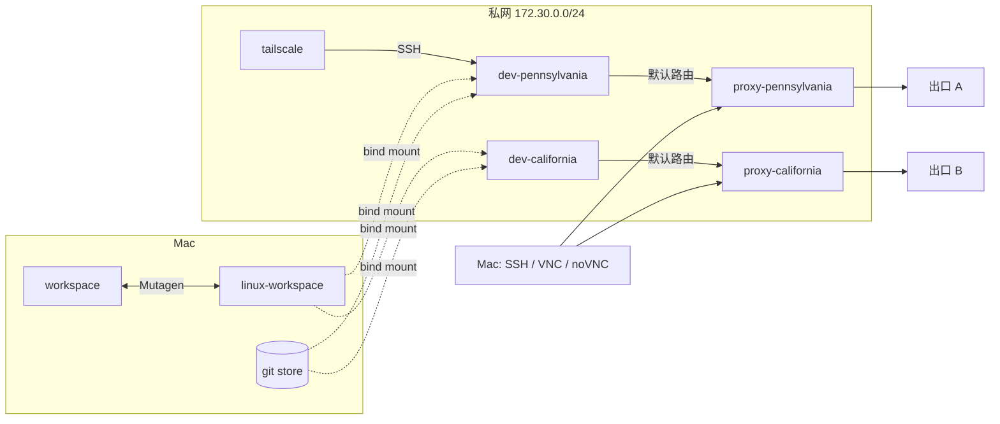

# 架构

cc-runtime 在一台 Mac（OrbStack 或其他 Docker 环境）上运行若干台 Linux 开发机。每台开发机有自己的身份和出口网关，所有开发机共用同一份工作区。本文说明系统的组成和各部分的设计取舍；工作区的同步、依赖隔离和 git 数据见 [工作区](workspace.md)。

## 组成

| 服务 | 网络 | 职责 |
|---|---|---|
| `dev-pennsylvania`、`dev-california` | 仅私网（`.10`、`.11`） | 开发机：开发工具、SSH、远程桌面 |
| `proxy-pennsylvania`、`proxy-california` | 私网（`.2`、`.4`）+ 出口网络 | 各自开发机的透明网关：TCP 代理、DNS、入站转发 |
| `tailscale` | 私网（`.3`）+ 出口网络 | 从 tailnet 转发 SSH 到 `dev-pennsylvania:22` |
| `*-network-init` | 临时共享对应开发机的网络命名空间 | 设置默认路由和 DNS 防绕过规则，然后退出 |

开发机按 `dev-{代号}` 命名，代号一般取它的出口地点。增加一台开发机，就是增加一个开发机服务、一个网关和一个 `network-init`，并在 `dev-runtimes/` 下放它的状态目录。

## 网络与网关

开发机只连私网，默认路由指向自己的网关。网关是一个 Mihomo 容器，在本地接收开发机的 TCP 连接，再按规则经代理链发出（TCP REDIRECT，不需要 TUN）。

- **没有直连回退。** 网关关闭内核 IP 转发并设置 `FORWARD DROP`；代理停止或上游不可用时，开发机的请求失败，而不是绕过代理。
- **DNS 不能绕过网关。** 开发机只能向网关发 DNS；发往外部 DNS 地址的 53 端口流量也由网关接管，Docker 内置 DNS `127.0.0.11` 被阻断。因此容器之间用固定 IP 互访，不依赖服务名解析。
- **普通 UDP 和 ICMP 不转发。** HTTP CONNECT 代理不能承载 UDP，QUIC/HTTP3 等会回退到 TCP 或不可用。IPv6 禁用。
- **开发机不持有网络权限。** 只有临时的 `network-init` 获得 `NET_ADMIN`；开发机移除了 `NET_RAW`，sudo 也不能修改网络规则。开发机不设置代理环境变量，不共享网关的网络、配置和凭据。

分流规则（哪些域名直连、哪些走哪条代理链）在 `proxy/config.example.yaml` 里，所有网关共用；每个网关只在标记为 `GATEWAY-SPECIFIC` 的块里定义自己的出口。修改流程见 [`proxy/README.md`](../proxy/README.md)。

### 入站

网关用 Mihomo 的固定 `DIRECT` tunnel 把宿主机端口转发到自己开发机的私网地址，这些连接不经过代理链：

| 开发机 | SSH | VNC | noVNC |
|---|---|---|---|
| `dev-pennsylvania` | `127.0.0.1:2222` | `127.0.0.1:5901` | `http://127.0.0.1:6080/vnc.html` |
| `dev-california` | `127.0.0.1:2223` | `127.0.0.1:5902` | `http://127.0.0.1:6081/vnc.html` |

端口只绑定宿主机的 `127.0.0.1`。网关还在私网上开一个端口（`<网关 IP>:10023`），转发到宿主机的 SSH（`host.docker.internal:22`），开发机可以借此在 Mac 上执行命令；该端口不发布到宿主机。

### Tailscale

`tailscale` 以 userspace 模式运行，不需要 TUN、`NET_ADMIN` 或宿主机端口。它通过 Tailscale Serve 把 tailnet 内的 TCP 22 转发到 `dev-pennsylvania:22`，SSH 认证由开发机的 OpenSSH 完成；不启用 Tailscale SSH、Funnel、子网路由或出口节点。登录状态在 `tailscale/state/`，重建后复用同一设备身份。

### 可见性边界

开发机能看到自己的私网地址和默认网关，看不到网关的规则和进程；但不能保证程序无法从出口 IP、延迟等推断出代理的存在。

本仓库位于共享的工作区内，所以开发机能读到仓库里的 `proxy/config-pennsylvania.yaml` 和 `.env`。需要「开发机读不到代理凭据」这条边界时，要把部署目录移到工作区之外。

## 开发机与身份

每台开发机是一台独立的机器：主机名、`machine-id`、SSH 主机密钥、遥测 ID、Claude Code 的登录都不共享。它们的状态放在仓库的 `dev-runtimes/<机器名>/`（不入 Git，不进构建上下文）：

| 路径 | 挂载到 | 内容 |
|---|---|---|
| `home/` | `/home/dev` | 家目录：shell 配置、工具、登录状态 |
| `ssh-host-keys/` | `/var/lib/cc-runtime/ssh` | SSH 主机密钥，重建后客户端不必重新信任 |
| `machine-id` | `/etc/machine-id`（只读） | 机器 ID |

`cc-runtime up` 在 Compose 创建开发机之前准备这些状态：

- **家目录**：第一次使用时从镜像复制 `/home/dev` 的初始工具和配置，不覆盖已有文件，不复制 `.claude`、`.claude.json`、`.cache`、`workspace`。之后重建镜像不会改动家目录，工具更新在开发机里自行完成。
- **`machine-id` 和 SSH 主机密钥**：已有就校验后沿用；没有时从同名服务的现有容器（包括已停止的）迁移；都没有才是一台新机器，生成新的。已有的密钥损坏时报错，不会悄悄换一套身份。
- **缓存**：每台开发机的 `~/.cache` 是一个外部 Docker 卷（`CACHE_VOLUME`）里的子目录，`compose down -v` 不会删除它。

新开发机的家目录可以用 `cc-runtime seed-home <现有家目录> <新家目录>` 初始化：复制工具链、包缓存和 shell 配置（macOS 上为写时复制克隆，不占额外空间），以及使用者选择共享的账号凭据（`internal/seed/seed.go` 中的 `Credentials`），不复制任何机器身份。

## 镜像

开发镜像 `ghcr.io/zeke-chin/cc-runtime` 提供 linux/amd64 和 linux/arm64。GitHub Actions 在两种架构的原生 runner 上分别构建，不使用 QEMU，全部成功后合并成多架构 manifest，发布 `latest` 和 `sha-*` 标签。构建上下文只包含 `scripts/entrypoint.sh` 和 `shell/`。

网关和 `network-init` 直接使用 `metacubex/mihomo` 镜像，不另外构建。
